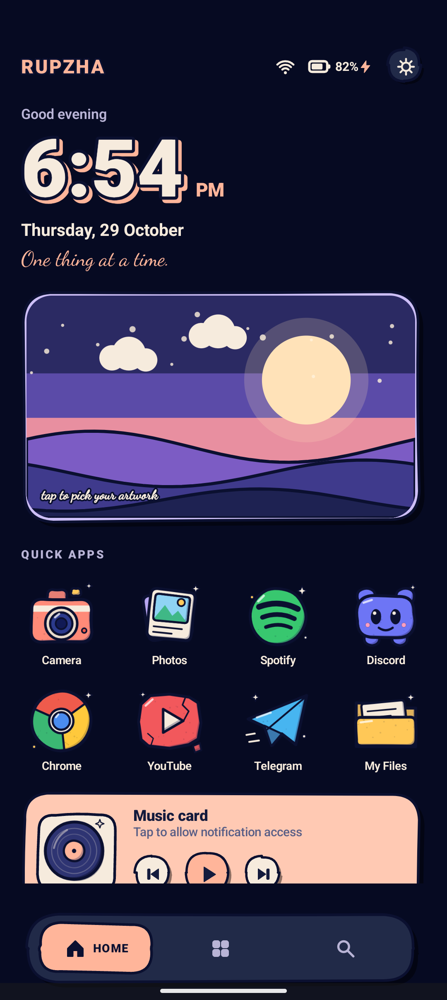
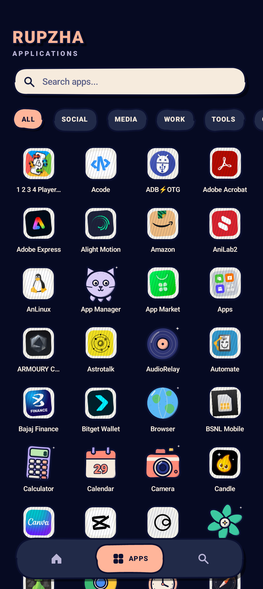
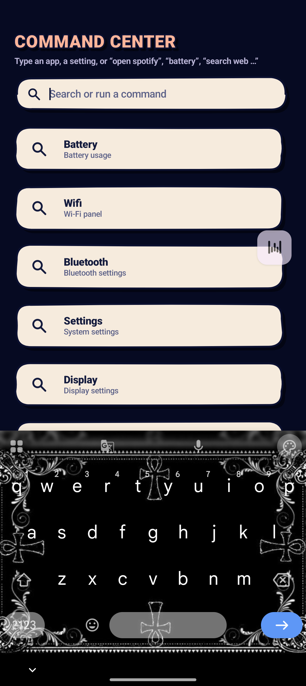

# RupZha Launcher

<p align="center">
  <strong>A Linux-inspired Android launcher built around the RupZha aesthetic.</strong><br>
  Dark. Minimal. Fast. Deliberately different.
</p>

<p align="center">
  <a href="https://github.com/Nihilanthrope/RupZha-Launcher/stargazers"></a>
  <a href="https://github.com/Nihilanthrope/RupZha-Launcher/issues"></a>
  <a href="https://github.com/Nihilanthrope/RupZha-Launcher/blob/main/LICENSE"></a>
  <a href="https://github.com/Nihilanthrope/RupZha-Launcher/commits/main"></a>
</p>

<p align="center">
  
</p>

## Overview

RupZha Launcher brings a **desktop-inspired workflow to Android**, taking visual and interaction cues from **Arch Linux and Hyprland** and adapting them for touch.

Instead of reproducing a stock Android home screen, RupZha is built around a focused visual system: immersive dark surfaces, strong typography, custom illustrated icons, quick actions, media controls, and a command-oriented search experience.

> **Project status:** Development is currently **paused**. The repository is kept public so the current work, design direction, and future ideas remain available.

## Highlights

- **Desktop-inspired UI** — Arch Linux / Hyprland-inspired visual language adapted for Android.
- **Three core surfaces** — Home, Applications, and Command Center.
- **RupZha icon system** — recognizable app artwork wrapped in a consistent hand-drawn, paper-and-ink style.
- **App discovery** — fast app search, categories, favorites, and hidden-app controls.
- **Command Center** — one place for app search and supported quick actions such as battery, Wi-Fi, Bluetooth, settings, and display controls.
- **Workspace-style surfaces** — launcher layouts designed around focused tasks rather than a conventional grid-only home screen.
- **Media integration** — media and notification features where Android permissions and system APIs allow.
- **Immersive experience** — fullscreen launcher presentation with performance-focused caching for icons and wallpaper.
- **Privacy-minded by design** — no analytics or tracking built into the launcher.

## UI Preview

The following are **full-device screenshots captured from the running launcher**.

### Home — daily workspace

Time, date, artwork, quick-launch apps, media controls, status information, and navigation are kept in one focused surface.

<p align="center">
  
</p>

### Applications — browse everything

The app drawer combines search, category filters, and the RupZha illustrated icon system into a single browsing surface.

<p align="center">
  
</p>

### Command Center — search and act

The Command Center turns launcher search into a quick-action interface for apps and supported device controls.

<p align="center">
  
</p>

## Design Direction

RupZha follows a simple visual principle: **make Android feel like a personal desktop environment without pretending a phone is a laptop.**

The interface combines:

- dark, high-contrast surfaces
- bold editorial typography
- soft cards and layered depth
- illustrated, hand-drawn iconography
- touch-first controls
- keyboard-friendly search and command patterns
- restrained motion and visual hierarchy

The result is intentionally closer to a **personal workspace** than a traditional launcher.

## Requirements

| Requirement | Minimum / Target |
| --- | --- |
| Android | 10+ (API 29+) |
| Target SDK | 35 |
| Root | Not required |
| JDK | 21 |
| Gradle | 8.10.2 |

## Build from Source

Clone the repository and build the debug APK:

```bash
git clone https://github.com/Nihilanthrope/RupZha-Launcher.git
cd RupZha-Launcher
gradle assembleDebug
```

RupZha currently uses **JDK 21** and **Gradle 8.10.2** for builds.

The generated APK is located at:

```text
app/build/outputs/apk/debug/app-debug.apk
```

## Install

With ADB enabled on your Android device:

```bash
adb install -r app/build/outputs/apk/debug/app-debug.apk
```

Then choose **RupZha Launcher** as the device's default Home app.

## Permissions

RupZha keeps optional integrations behind Android's normal permission model. Features that depend on accessibility or notification access only request those capabilities when needed.

## Project Structure

```text
RupzhaLauncher/
├── app/
│   └── src/main/
│       ├── java/com/rupzha/launcher/
│       │   ├── MainActivity.kt
│       │   ├── IconArt.kt
│       │   ├── Components.kt
│       │   └── ...
│       └── res/
├── docs/
│   └── screenshots/
├── LICENSE
├── README.md
├── build.gradle.kts
└── settings.gradle.kts
```

## Current Status

**Paused for now.**

The current public build represents the direction of the launcher, including its main UI surfaces and illustrated icon system. Development is intentionally parked while other RupZha work takes priority.

Future work may include:

- more launcher customization
- broader icon artwork coverage
- additional command actions
- performance improvements across more Android devices
- automated Android build checks
- further UI and workspace experiments

The project should be treated as **experimental software**, not a finished production launcher.

## Contributing

Issues, ideas, and pull requests are welcome when development resumes.

For bug reports, include:

1. Android version
2. Device model
3. RupZha Launcher version / build
4. Steps to reproduce
5. Expected behavior
6. Actual behavior
7. Screenshots or logs when relevant

Before opening a new issue, check the existing [open issues](https://github.com/Nihilanthrope/RupZha-Launcher/issues).

## License

RupZha Launcher is released under the **MIT License**. See [`LICENSE`](LICENSE) for the full text.

---

<p align="center">
  <sub>Built as an open-source experiment in bringing desktop-inspired workflows to Android.</sub>
</p>
