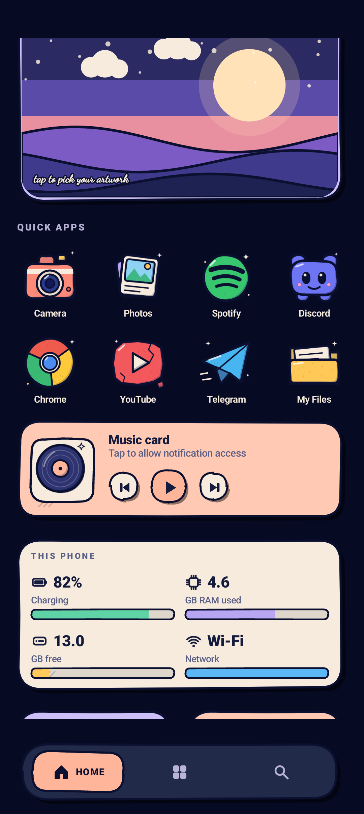

# RupZha Launcher

> A Linux-inspired Android launcher built around the RupZha aesthetic — dark, fast, minimal, and a little different from the usual Android home screen.

<p align="center">
  
</p>

<p align="center"><strong>RupZha Launcher — desktop-inspired UI, rebuilt for Android.</strong></p>

## What it looks like

RupZha takes cues from **Arch Linux / Hyprland-style desktop workflows** and turns them into a touch-first launcher:

- dark, immersive home screen
- custom app artwork and icon treatment
- quick app search and drawer
- favorites and hidden apps
- workspace-style surfaces
- RupZha Control Center
- media and notification integrations
- configurable themes, accents, layouts and cards
- performance-focused caching

## In short

```text
┌──────────────────────────────┐
│ RUPZHA                       │
│                              │
│        22:41                 │
│        Wed · 29 Oct          │
│                              │
│  ┌──────┐ ┌──────┐ ┌──────┐ │
│  │ Apps │ │ Media│ │Stats │ │
│  └──────┘ └──────┘ └──────┘ │
│                              │
│  Search apps...              │
│                              │
│  ● Favorites   ● Workspace   │
└──────────────────────────────┘
```

*The actual UI is visual and touch-first; the diagram above is only a quick idea of the layout.*

## Features

- Linux-inspired launcher UI
- Fast app drawer and app search
- Favorites and hidden-app controls
- Custom themes, accents, icon styles, cards and layouts
- Workspace-style launcher surfaces
- RupZha Control Center
- Media and notification integrations where Android permissions allow
- Accessibility-powered launcher actions
- Immersive fullscreen home experience
- Performance-focused icon and wallpaper caching
- No analytics or tracking built into the launcher

## Requirements

- Android 10+ (API 29+)
- Android 15/16 compatible target
- No root required

## Build

Install Android Studio or an Android SDK with the required platform/build tools, then run:

```bash
./gradlew assembleDebug
```

The generated debug APK will be under `app/build/outputs/apk/debug/`.

## Install

```bash
adb install -r app/build/outputs/apk/debug/app-debug.apk
```

Then select **RupZha Launcher** as the default Home app.

## Permissions

RupZha Launcher keeps optional integrations behind Android's normal permission system. Accessibility and notification access are only needed for the features that use them.

## Project status

RupZha Launcher is an active open-source project. Expect rapid UI changes, experiments, and occasional rough edges while the launcher evolves.

## Contributing

Issues and pull requests are welcome. If you find a bug, include:

1. Android version and device model
2. RupZha Launcher version
3. Steps to reproduce
4. What you expected
5. What actually happened

See the open issues for planned improvements and ideas.

## License

MIT License. See [`LICENSE`](LICENSE).
